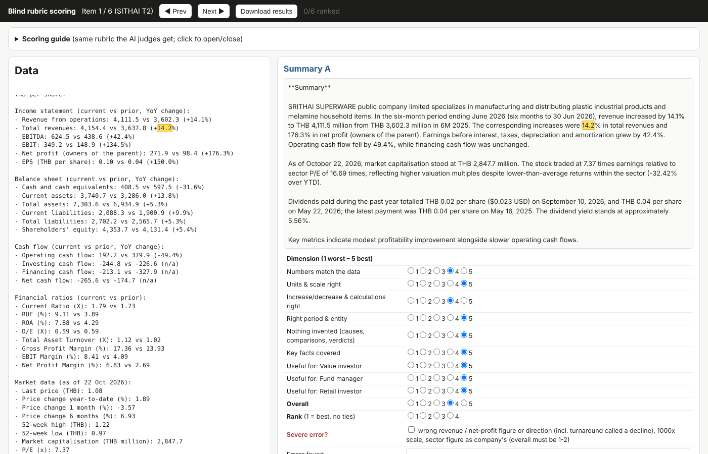
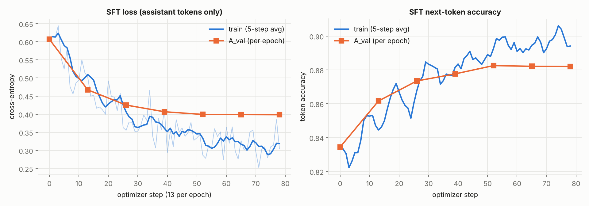
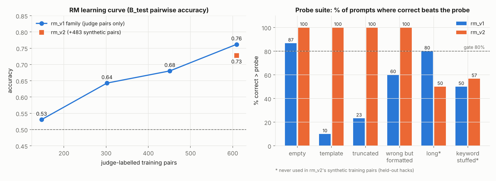
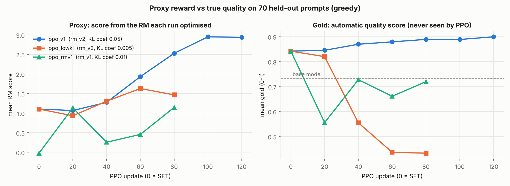
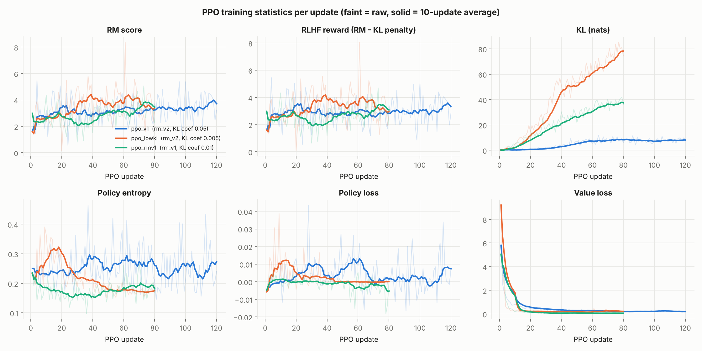
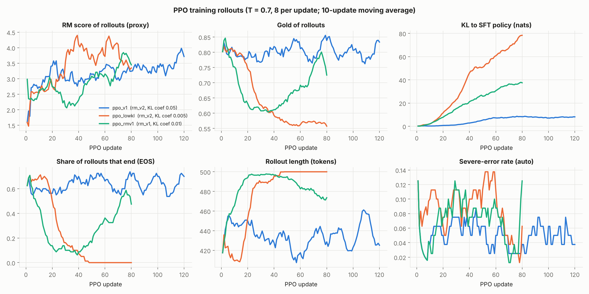
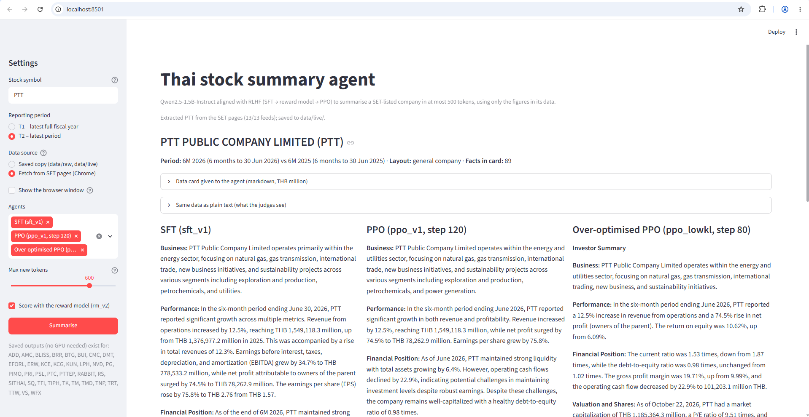

# AIPI 591: Challenge 2: RLHF for Thai Stock Summaries
### **Author**: Matana Pornluanprasert

This project runs a full RLHF loop with HuggingFace TRL on a small language model, Qwen2.5-1.5B-Instruct: collect preference data, fine-tune (SFT), train a reward model, and apply PPO. The model writes short English investor summaries (at most 500 tokens) of companies listed on the Stock Exchange of Thailand (SET), using only the figures in the company's data. The reward model is only a proxy for summary quality, so the project measures quality with a rule-based gold score that PPO never sees, a held-out AI judge and blind human ratings – and predicts the likely reward hacks before PPO with a probe suite. The PPO model does better than both the SFT model and the base model on the main yardsticks (gold score 0.90 vs 0.84 vs 0.73; preferred over SFT by the held-out judge in 74% of prompts and by the human in 8 of 12 pairs). Loosening its KL penalty, however, shows reward hacking exactly as the probes predicted.<br>
<br>


***
# The Agent Task<br>
The goal is a **summary agent built on a small, open-source LLM** that turns one listed company's number-heavy financial tables into a summary of at most 500 tokens, so that readers with different backgrounds – retail investors, institutional investors, value investors and fund managers – can digest the key points quickly. Publicly available small models can already write such summaries, but they were not trained for financial or investment tasks, and it shows: they mis-copy figures, get rises and falls wrong and add opinions the data does not support. RLHF is used to teach a 1.5B model to do this one job well.<br>

Given one company's data card (business description, income statement, balance sheet, cash flow, ratios, valuation, dividends, shareholders; current period vs prior period), the agent writes a summary that covers the business, revenue and net profit with growth, financial position, valuation and dividends. The rules:
* Copy every figure exactly, with the right unit (THB million) and period, and get every rise or fall right.
* Do not invent causes ("driven by lower costs"), peer comparisons, forecasts or verdicts on ratios ("healthy liquidity"), and give no buy/sell advice.
* Stay within 500 tokens.

Typical base-model failures: amounts off by 1,000x, a loss-to-profit turnaround described as a decline, the sector's P/E presented as the company's, invented causes and wrong verdicts on ratios.<br>
<br>


***
# Data Source<br>
Company data comes from two public pages per company on the SET website (English version), with PTT as the example:
* Factsheet: https://www.set.or.th/en/market/product/stock/quote/PTT/factsheet
* Company highlights: https://www.set.or.th/en/market/product/stock/quote/PTT/financial-statement/company-highlights

As these pages render, they load their figures as structured (JSON) data. `src/fetch_set_pages.py` opens the pages in Chrome through Selenium, reads that data from the browser's network log, and parses the business description and dividend policy from the factsheet HTML; it sends no requests of its own. Each company was collected once, one page at a time with a pause between pages, and saved to `data/raw/{SYMBOL}.json`. Amounts are THB thousands and are converted to THB million. Each file holds 13 records:<br>

| # | Record | Contents | Page |
|---|---|---|---|
| 1 | `overview` | name, market, industry and sector, SET ESG rating, CG score, index membership | Factsheet |
| 2 | `profile` | business description, dividend policy (plus the overview fields above) | Factsheet |
| 3 | `info` | last price, 52-week high/low, market cap, P/E, P/BV, dividend yield | Factsheet |
| 4 | `balance_sheet` | balance sheet by period | Factsheet |
| 5 | `income_statement` | income statement by period | Factsheet |
| 6 | `cash_flow` | cash flow statement by period | Factsheet |
| 7 | `financial_ratio` | profitability, liquidity and leverage ratios by period | Factsheet |
| 8 | `financial_growth` | growth rates by period | Factsheet |
| 9 | `price_performance` | price change (1M/3M/6M/YTD) for the stock, its sector and the SET index | Factsheet |
| 10 | `highlight_financial` | headline financials by year and latest period | Company highlights |
| 11 | `highlight_trading` | year-end close, high/low, market cap, P/E, P/BV, yield and beta by year | Company highlights |
| 12 | `shareholder` | top shareholders, number of shareholders, free float | Factsheet |
| 13 | `dividend_xd` | cash dividend history (XD dates, amounts, payment dates) | Factsheet |

* **342 companies collected; 25 excluded** after quality checks: 17 property funds, REITs and infrastructure funds (a different statement layout), 3 suspended stocks, 4 with no prior-period data, and 1 whose English feed contained only Thai text. Their data files were removed from the repository; the reason for each exclusion is recorded in `data/qc_report.csv`.
* **Two prompts per company:** T1 = latest full fiscal year (FY2025) vs the prior year, market data at end-2025; T2 = latest reported period (e.g. 6M 2026) vs the same period a year earlier, market data at 22 Oct 2026.
* **Five statement layouts handled:** general companies, banks, insurers, finance/leasing and securities companies.
* **Splits by company** (stratified by market and industry, so no company appears in both training and evaluation):

| Split | Purpose | Companies | Prompts | % of its set | % of all companies | Labelled by |
|---|---|---|---|---|---|---|
| Pilot | prompt, card format and judge selection | 12 | 24 | – | 3.8% | Sonnet, GPT, Grok |
| A_train | SFT targets | 54 | 108 | 90.0% of A | 17.0% | Sonnet + GPT |
| A_val | SFT validation | 6 | 12 | 10.0% of A | 1.9% | Sonnet + GPT |
| B_train | reward-model training pairs | 66 | 132 | 74.2% of B | 20.8% | Sonnet + GPT |
| B_val | reward-model validation pairs | 8 | 16 | 9.0% of B | 2.5% | Sonnet + GPT |
| B_test | reward-model test pairs, probes, human check | 15 | 30 | 16.9% of B | 4.7% | Sonnet + GPT, Grok, human |
| C_ppo | PPO prompts (no labels needed) | 30 | 60 | 19.2% of C | 9.5% | reward model |
| Reserve (also PPO prompts) | PPO prompts (no labels needed) | 106 | 212 | 67.9% of C | 33.4% | reward model |
| C_eval | final evaluation | 20 | 40 | 12.8% of C | 6.3% | gold score, Grok, human |
| **Total** | | **317** | **634** | | **100%** | |

**Why "reserve" is a separate row.** The first sample was 232 companies (12 pilot + 220 split into A, B and C). The 106 reserve companies were collected later as spares, before we knew whether the first sample would be enough, and were kept out of the labelled sets so that they could be added anywhere without disturbing them. They were used twice, and never labelled: first for a base-model card-format check, then **as PPO prompts** – C_ppo alone has only 60 prompts, which the main PPO run (120 updates x 8 rollouts = 960 rollouts) would repeat 16 times each; with the reserve the pool is 272 prompts (about 3.5 rollouts per prompt). For PPO, C_ppo and the reserve are one pool.<br>

Full counts and labelling work: [`docs/DATA_AND_LABELS.md`](docs/DATA_AND_LABELS.md).<br>
<br>


***
# Preference Data: How Scores Are Collected<br>

| Rater | Model / tool | Used for | What it scores |
|---|---|---|---|
| **Claude Sonnet** | Claude Sonnet 5.5, through the Claude Code CLI (`claude --model sonnet`) | training labels (sets A and B) | rubric, both candidate orders |
| **GPT** | GPT through the Codex CLI (`codex exec`, the workspace's default model) | training labels (sets A and B) | rubric, both candidate orders |
| **Grok** | Grok 4.6, high reasoning effort, through the Cursor CLI (`cursor-agent --model cursor-grok-4.6-high`) | evaluation only (never a training label) | rubric on the pilot, B_test and C_eval |
| **Human** (author) | blind HTML form (`labeling/*.html`) | validation of the AI labels and the final comparison | the same rubric: 6 B_test prompts (24 candidates) and 12 SFT-vs-PPO pairs |

* **AI judges:** `src/judge.py` sends the data card and the candidates (4 per prompt; 3 in C_eval) to the judge's command-line tool with the rubric, and asks for JSON: six 1–5 dimension scores, a severe-error flag and a list of errors per candidate, usefulness for three investor personas, an overall 1–5 score and a ranking. Each prompt is judged twice per judge – shuffled order and reversed order – to cancel position bias. Scores are averaged over judges and orders.
* **Human:** `src/make_label_form.py` builds a self-contained HTML form with the same rubric (a "Scoring guide" panel shows the exact text the AI judges get). Candidates appear under neutral letters in a random order, so the rater cannot tell which model wrote them; hovering over a number in a summary highlights it in the data panel. The form downloads the scores in the same JSON format as the AI judges, so the same analysis code compares them.
* **From scores to training data:** for SFT, the candidate with the highest mean overall score is the target (corrected by an editor model if it fails a quality check); for the reward model, every pair of candidates whose mean overall scores differ by at least 0.5 becomes a preference pair, with the gap as the margin.



**Why AI judges instead of humans.** Scoring with the full rubric took the human rater a median of **27 minutes per prompt** (4 candidates; every figure has to be checked against the data card) and **9 minutes per SFT-vs-PPO pair**. At that pace, replacing the AI judges with people would take roughly:

| Work done by AI judges in this project | Judgments | Human time at 27 min (4 candidates) / 20 min (3 candidates) |
|---|---|---|
| Set A labels (120 prompts x 2 judges x 2 orders) | 480 | ≈ 216 h |
| Set B labels (178 prompts x 2 judges x 2 orders) | 712 | ≈ 320 h |
| Grok evaluation (pilot 48, B_test 30, C_eval 80) | 158 | ≈ 62 h |
| Editor corrections of SFT targets | 100 | ≈ 15–30 h (10–15 min each) |
| **Total** | **1,450** | **≈ 620 h** – about 78 eight-hour working days |

Even one rater scoring each prompt once (no second judge, no reversed order) would need about 300 prompts x 27 min ≈ 135 hours for the training labels alone. Sessions of that length cause eye fatigue from cross-checking hundreds of numbers, and attention and judgement drift over the day, so label quality would fall as the work goes on. The AI judges did the same work in hours, consistently and in parallel. Humans were used where their judgement matters most and the volume is small: validating the AI labels (6 B_test prompts) and the final SFT-vs-PPO comparison (12 pairs).<br>
<br>


***
# Rubric and Gold Score<br>
Two independent yardsticks decide whether a candidate summary is acceptable. The **rubric** produces the training labels and the judges' evaluation; the **gold score** is computed by code and is never shown to the reward model or PPO, so it can reveal reward hacking.<br>

**Rubric** (same text for Sonnet, GPT, Grok and the human; verbatim in [`docs/DATA_AND_LABELS.md`](docs/DATA_AND_LABELS.md)). Each candidate is scored from 1 (worst) to 5 (best) on six dimensions, each with written anchors:

| Dimension | Question | 5 | 1 |
|---|---|---|---|
| Fidelity | Are the numbers the ones in the data? | all correct | four or more wrong, or revenue / net profit wrong |
| Units | Correct unit and scale on every amount? | all correct | any amount off by 1,000x |
| Direction | Every rise/fall and calculation right? | all correct | wrong direction on revenue or net profit, or a turnaround called a decline |
| Attribution | Right period and right entity? | all correct | a sector figure presented as the company's, or the prior period as current |
| Invented claims | Only what the data supports? | nothing added | invented causes throughout, or wrong verdicts on ratios |
| Coverage | Business, revenue and profit with growth, financial position, valuation, dividends? | all present | mostly missing |

* **Overall score (1–5):** a holistic judgement assigned by the judge, not computed from the six dimensions: 5 = accurate and useful with at most trivial issues, 4 = good with minor issues, 3 = usable with clear weaknesses, 2 = misleading in places, 1 = unreliable. Advice, chat filler and running past 500 tokens lower it; length is not a merit. In practice it follows the worst dimension (correlation 0.84 with the minimum of the six) and weighs invented claims most.
* **Severe error (narrow definition):** a wrong revenue or net-profit figure; a wrong rise/fall on revenue or net profit (including a loss-to-profit turnaround called a decline); an amount off by 1,000x; a sector figure presented as the company's. A severe error forces the overall score to 1 or 2. Invented causes, wrong verdicts on ratios, advice and wrong directions on minor items are *not* severe – they are scored under the dimensions instead. (A first, broader definition made GPT flag 99% of summaries as severe and was replaced after the pilot.)
* **Usefulness (1–5)** for three readers: value investor, fund manager, retail investor (an SFT tie-breaker and an evaluation detail only).
* **Objective in the pipeline:** the overall score chooses the SFT targets and defines the reward model's preference pairs and margins; the dimensions, errors and severe flags gate and correct the SFT targets and give the failure taxonomy in evaluation.

**Gold score (0–1, `src/auto_rubric.py`)**. Every number in the summary is extracted and matched against the company's fact list (allowing rounding, THB million/billion, signs and percentages):

`composite = 0.30 fidelity + 0.20 direction & attribution + 0.15 units + 0.15 coverage + 0.10 invented + 0.10 discipline`

| Component | How it is computed (each 0–1) |
|---|---|
| Fidelity | share of the summary's numbers found in the data |
| Direction & attribution | 1 − 0.34 x wrong rise/fall words − 0.20 x attribution errors (sector as company, prior period as current) |
| Units | 1 − 0.34 x 1,000x scale errors − 0.10 x amounts missing a scale word |
| Coverage | half: share of key facts reported; half: share of required sections present |
| Invented | 1 − 0.10 x causal / comparative / forecast phrases − 0.03 x evaluative phrases |
| Discipline | 1 − 0.25 x each of: over 500 tokens, truncated, chat filler, buy/sell advice |

Then caps: an **automatic severe error** (wrong rise/fall on revenue or net profit, a 1,000x error, a sector figure as the company's) caps gold at 0.4; a **non-answer** (no numbers, or under 30 words) scores 0; no headline figure at all caps at 0.4; a **truncated** answer caps at 0.6; **keyword stuffing** caps at 0.5; above **500 tokens** gold is multiplied by max(0.5, 1 − (tokens − 500)/400). The weights were fixed before training; the caps were added after the probe test and before any PPO run, and nothing was changed afterwards.<br>

* **Objective in the pipeline:** gold is **never part of any reward**. It gates the SFT targets (and re-checks every editor correction), is logged on every PPO update and checkpoint, and is the main evaluation metric – the yardstick that shows whether a rising reward-model score is real improvement.
* **Different ranges:** the overall score runs from 1 to 5 (integers per judgment, averaged over judgments); gold runs from 0 to 1 (continuous). They are not on the same scale and agree only moderately (Spearman 0.26–0.43): the judges read meaning, gold checks mechanics.<br>
<br>


***
# Design Choices<br>
* **Card format and prompt chosen by experiment:** markdown tables (amounts in THB million) beat plain text, JSON and raw JSON on number accuracy; the `guided_v2` prompt removed chat filler and rescaling errors (`outputs/base_runs/exp1_*`, `exp2_*`, `fmt_check_*`).
* **AI judges for the training labels, a different AI judge for evaluation:** Grok never produces a training label, so it can judge PPO fairly.
* **Judge-corrected SFT targets:** the base model's best candidate passed a strict quality check for only 16 of 120 prompts, so an editor model (Sonnet or GPT) minimally corrected the errors the judges listed, keeping the model's own style.
* **Reward model with margins:** the score gap between the two candidates of a pair becomes the margin in the Bradley–Terry loss, so clear wins must win by more.
* **A probe suite before PPO:** synthetic "hacked" answers (empty, template, truncated, wrong but well formatted, padded to 700 tokens, keyword-stuffed) test whether the reward model can be fooled, and predict which hack PPO will find.<br>
<br>


***
# Model Selection<br>
* **Policy: Qwen2.5-1.5B-Instruct** with LoRA (r16, alpha 32). It followed the instructions and copied numbers far more accurately than Gemma 3 1B in the pilot (97% vs 88% of numbers found in the data).
* **Reward and value models: Qwen2.5-0.5B-Instruct** with a scalar head (same tokenizer as the policy), fully fine-tuned; the value model starts from the reward model.
* **Why these sizes:** larger models (e.g. Qwen2.5-3B or 7B as the policy, or a 1.5B reward model) would very likely summarise and judge better, but PPO keeps four models in memory at once (policy, reference, reward and value; the reference shares the policy's weights through LoRA). With these two sizes the whole PPO setup fits on a single 16 GB GPU (peak 14.9 GB), so every stage could be trained on our own hardware.
* **TRL 1.12.0:** the last release that includes `PPOTrainer` (`trl.experimental.ppo`); it was removed in TRL 1.13.
* **Hardware used:** an RTX 5060 Ti 16 GB GPU for training (generation and evaluation also run on an 8 GB GPU).<br>
<br>


***
# RLHF Pipeline<br>

| Stage | Data | Setting | Result |
|---|---|---|---|
| SFT (`sft_v1`) | 103 judge-corrected targets (+12 validation) | LoRA r16, lr 1e-4, 6 epochs, loss on the summary tokens only | validation loss 0.607 -> 0.399; next-token accuracy 83% -> 88% |
| Preference data | SFT model writes 4 candidates per prompt (1 greedy + 3 sampled at T = 0.8); 712 judgments | 6 pairs per prompt, kept if the judges' gap ≥ 0.5 | 609 train / 76 validation / 147 test pairs; Sonnet and GPT agree on 97% of pairs |
| Reward model (`rm_v1`) | 609 pairs | Bradley–Terry with margin, 2 epochs | test accuracy 0.76, but fails the probe suite |
| Reward model (`rm_v2`) | 609 + 483 synthetic "correct beats broken" pairs | same | test accuracy 0.73, passes the probe suite |
| PPO (`ppo_v1`) | 272 unlabelled prompts | 8 rollouts per update, KL coefficient 0.05, lr 1e-5, 120 updates | see results |
| Ablation `ppo_lowkl` | same | KL coefficient 0.005, lr 3e-5, 80 updates | over-optimisation |
| Ablation `ppo_rmv1` | same, flawed `rm_v1` | KL coefficient 0.01, lr 3e-5, 80 updates | quality falls |

The reward-model test accuracy kept rising as more pairs were added (0.53 / 0.64 / 0.68 / 0.76 with 25 / 50 / 75 / 100% of the pairs), so more preference data would likely still help.<br>
<br>


***
# Reward Design<br>
* **PPO reward per response:** reward-model score − β x KL(policy ‖ SFT policy) − 1.0 if the response has no end-of-text token (it ran into the 500-token cap). β is the KL coefficient that keeps the policy close to the SFT model.
* **rm_v1** learns only from the judges' preference pairs. **rm_v2** adds synthetic "correct beats broken" pairs: the best judged summary of a B_train prompt is the chosen answer, and automatically broken copies of it (template text, cut off at 40–70%, empty, a ×1000 error or a flipped rise/fall) are the rejected ones, with margin 2.0. Two hacks were left out on purpose – padding and keyword stuffing – so the probes can still test what the reward model does with hacks it was never shown.
* **Probe gate before PPO** (agreed in advance): test accuracy ≥ 0.65, and the correct answer must outscore the empty, template and truncated probes in ≥ 80% of prompts.<br>
<br>


***
# Results and Evaluation<br>

### **Base vs SFT vs PPO** (`ppo_v1`, step 120)

| Yardstick | Base | SFT | **PPO** |
|---|---|---|---|
| Gold score (0–1), 70 held-out prompts | 0.732 | 0.842 | **0.899** |
| Severe errors (automatic) | 27.1% | 8.6% | **2.9%** |
| Reward-model score (rm_v2) | −0.05 | 1.11 | **2.94** |
| Response length (tokens) / over 500 tokens | 375 / 8.6% | 419 / 20.0% | 445 / 25.7% |
| Grok overall (1–5), C_eval | 1.75 | 2.66 | **3.12** |
| Grok fidelity / direction / invented claims | 2.95 / 2.66 / 1.60 | 3.84 / 3.00 / 3.14 | **4.09 / 3.12 / 4.20** |
| Grok usefulness (3 personas) | 1.82 | 2.73 | **3.17** |
| Grok severe-error flag | 44% | 26% | 26% |
| Head-to-head (Grok) | – | beats base 30–7 (3 ties) | **beats SFT 23–8 (9 ties), 74%** |
| Blind human, 12 pairs vs SFT | – | 4 preferred | **8 preferred** |

### **SFT**
| Metric | Before | After SFT |
|---|---|---|
| Validation loss (A_val) | 0.607 | **0.399** (best at epoch 6; flat from epoch 4) |
| Validation next-token accuracy | 83.4% | **88.2%** |
| Gold score on held-out prompts | 0.732 | **0.842** |
| Severe errors (automatic) | 27.1% | **8.6%** |



### **Reward model**
| Reward model | Training pairs | Test accuracy | Calibration error (ECE) | Correct beats empty / template / truncated | Correct beats long* / keyword-stuffed* |
|---|---|---|---|---|---|
| rm_lc25 / lc50 / lc75 | 147 / 302 / 451 | 0.53 / 0.64 / 0.68 | 0.25 / 0.20 / 0.14 | – | – |
| **rm_v1** | 609 | **0.76** | 0.13 | 87% / **10%** / **23%** (fails) | 80% / 50% |
| **rm_v2** | 609 + 483 synthetic | 0.73 | 0.11 | 100% / 100% / 100% (passes) | **50%** / 57% |

ECE (expected calibration error) = average gap between the reward model's confidence in a pair and its actual accuracy (0 = perfectly calibrated). \* never used in rm_v2's synthetic pairs. The reward models agree with Grok, a judge they never learned from, as often as with their own training judges (rm_v2: 0.72 vs 0.73), and match the human's ranking in 64–72% of pairs.<br>



### **PPO checkpoints and ablations** (greedy, 70 held-out prompts)
| Model | Reward-model score (proxy) | Gold score (0–1) | Severe errors (auto) | Over 500 tokens | Cut off at the cap |
|---|---|---|---|---|---|
| Base | −0.05 | 0.732 | 27.1% | 8.6% | 2.9% |
| SFT | 1.11 | 0.842 | 8.6% | 20.0% | 2.9% |
| **PPO `ppo_v1` (step 120)** | **2.94** | **0.899** | **2.9%** | 25.7% | 4.3% |
| PPO `ppo_lowkl` (step 80) | 1.47 | 0.433 | 11.4% | 98.6% | 97.1% |
| PPO `ppo_rmv1` (step 80) | 1.15 (rm_v1) | 0.720 | 20.0% | 55.7% | 17.1% |





**Human vs AI judges (B_test, 6 prompts, 24 candidates):** the human picks the same better summary as Sonnet / GPT / Grok in 86% / 95% / 89% of pairs, nearly as often as the judges agree with each other (95–97%).<br>

Every table and more detail: [`docs/RESULTS.md`](docs/RESULTS.md).<br>
<br>


***
# Analysis of Misalignment and Overoptimization<br>
**1. A misaligned reward model, caught before PPO (rm_v1).** rm_v1 had the best pairwise accuracy (0.76), yet it scored a generic template with no company figures *above* the correct summary in 90% of test prompts, and a summary cut off mid-sentence above it in 77%. Every labelled candidate was a complete SFT summary, so it had never seen such text and had no reason to dislike it. Accuracy on natural pairs said nothing about these failure modes; only the probes exposed them.<br>

**2. Over-optimisation when the KL leash is loosened (ppo_lowkl).** rm_v2 fixed the probed failures but still rated a padded 700-token answer above the correct one in half of the prompts. With a 10x weaker KL penalty, PPO found exactly that gap: the policy learned never to stop writing. From update 41 on, every training rollout ran to the 500-token cap, and the −1.0 penalty for not finishing was smaller than what the reward model paid for extra text. The outputs finish the real summary, then append repeated sections until they are cut off:

> **Key Takeaway:** In the six-month period ended June 2026, AMC reported a decrease in revenue but an increase in net profit … **Price Performance:** … **P/E Ratio:** The P/E ratio was 11.96 times, and the sector P/E was 11.28 times. **Dividend Yield:** … **Beta:** The beta was 0.15. **Sector Price Change:** The sector price changed by 2.03% over the

The padding also brought filler verdicts the data does not support (e.g. "premium valuation" when the company's P/E of 13.07 is *below* the sector's 21.62) and keyword-stuffed phrases in 14% of outputs. The reward-model score rose (1.11 -> 1.63) while gold halved (0.84 -> 0.43): Goodhart's law in one plot.<br>



**3. A flawed reward model degrades quality even without its predicted collapse (ppo_rmv1).** rm_v1 over-rewards templates, but PPO never reached that mode – sampling from the SFT policy does not produce number-free text, even at KL 37. It drifted towards length instead (over 500 tokens in 56–90% of outputs), and severe errors more than doubled (8.6% -> 20%). A probe failure warns of trouble even when the exact predicted hack does not appear.<br>

**4. A second reward model is not a safe referee.** While ppo_lowkl's gold fell, the *other* reward model (rm_v1) also scored the padded outputs higher (−0.02 -> 0.83). Both reward models learned a preference for length that the labels never contained (the chosen summary was the longer one in only 44% of pairs). Only the rule-based gold score and the held-out judge exposed the decline.<br>

**5. The quieter misalignment in the successful run (ppo_v1).** PPO improved what the reward model could see: Grok's invented-claims score rose from 3.14 to 4.20, and the reward model weighs this most because the judges do. But meaning-level errors – e.g. a smaller profit described as a "loss" – stayed at 26% by Grok's count and rose from 3 to 4 of 12 by the human's, while the automatic severe rate fell to 2.9%. The proxy and the gold score both missed part of this, so the improvement is real but narrower than the reward curve suggests.<br>

**6. Training rollouts show divergence earlier than greedy outputs.** In ppo_v1 the reward-model score of the sampled training rollouts rose from 2.7 to 3.7 while their gold stayed flat (0.77–0.84) – a first sign of proxy–gold divergence that the cleaner greedy outputs did not show. Logging gold on every update, not only at checkpoints, is what made it visible.<br>

**7. The gold score can be gamed too.** Before PPO, the probes showed the plain weighted gold sum gave an empty answer 0.53 and a keyword-stuffed answer 0.95 (vs 0.96 for a correct one). Caps were added before any PPO run and then frozen; without them, the ppo_lowkl hack would have looked almost harmless by gold.<br>
<br>


***
# Lessons Learned<br>
1. **Pairwise accuracy does not make a reward model safe.** The most accurate reward model failed 2 of 3 basic probes; probes caught it before PPO.
2. **Probes predict the hack.** rm_v2 was trained to reject four kinds of broken answer, and two hacks were deliberately left out: *padding* (the correct summary extended to about 700 tokens by restating its own figures) and *keyword stuffing* (a paragraph of rubric-sounding words such as "accurate, data-supported, verified, THB million" appended to it). The probes showed rm_v2 rated the padded answer above the correct one in half of the prompts. That was the prediction, and it came true: with a weak KL penalty, PPO learned to keep writing until the length cap, and some outputs also picked up stuffed phrases (14%). The reward model generalised from "broken" examples it had seen to nothing else.
3. **The KL penalty kept PPO honest.** At KL coefficient 0.05 proxy and gold rose together; at 0.005 the same reward model was exploited within 40 updates.
4. **Use a referee that cannot be optimised.** A second learned reward model shared the first one's length bias; only the rule-based gold score and the held-out judge exposed the decline.
5. **The gold score needed its own probes.** The original weighted sum gave an empty answer 0.53 and a keyword-stuffed one 0.95; caps were added before PPO and then frozen.
<br>


***
# Limitations<br>
* One task, one policy size (1.5B) and one seed per run; PPO runs of 80–120 updates.
* Evaluation on 70 held-out prompts (40 for Grok, 12 human pairs): differences of a few points are within noise.
* Training labels come from two AI judges; the human check is a single rater on a small sample.
* 41 of 103 SFT targets exceed the 500-token budget, which pushed outputs towards the length cap from the start.
* The automatic gold score is rule-based: it misses some meaning-level errors (e.g. a profit described as a loss without a rise/fall word) and paraphrased advice.
* The template text in the probes is the same as in rm_v2's synthetic training pairs, so only the padded and keyword-stuffed probes are truly unseen hacks.<br>
<br>


***
# Ethics statement<br>
This project is intended for research and educational purposes in reinforcement learning. Company data is public information published by the Stock Exchange of Thailand, collected once at a low request rate and kept as raw files; no personal data is used, and shareholder names in Thai are replaced by their type. The summaries are not investment advice: the model is trained not to give buy/sell recommendations, and the results show that even the aligned model still makes meaning-level errors, so its output must be checked against the source data before anyone relies on it.<br>
<br>


***
# Files<br>

| Path | Contents |
|---|---|
| `data/raw/` | one JSON per company: the 13 records from its SET quote pages, as collected (317 companies used) |
| `data/cards/` | model input (markdown) and judge input (text), one file per company x period |
| `data/facts/` | every number shown in a card, in standard units (for the gold score) |
| `data/qc_report.csv`, `data/keep_symbols.txt`, `data/pilot_symbols.txt`, `data/splits.csv` | keep/drop decision per company; kept companies; the 12 pilot companies; company -> split |
| `data/judge_items/` | judging items (one data card + candidate summaries) |
| `data/sft/` | SFT targets (A_train, A_val) and the candidate score table |
| `data/rm/` | reward-model pairs (train / val / test), synthetic pairs, probes and the candidate score table |
| `labeling/` | blind human scoring forms (HTML) and `results/` |
| `outputs/base_runs/` | generations (base, SFT) and their automatic scores |
| `outputs/judgments/` | AI-judge and human judgments |
| `outputs/corrections/` | editor-corrected SFT targets |
| `outputs/train_logs/` | SFT / reward model / PPO logs and checkpoint evaluations |
| `outputs/eval_runs/` | greedy outputs of every evaluated checkpoint |
| `outputs/ppo_rollouts/` | PPO training rollouts with reward-model scores |
| `outputs/figures/` | figures |
| `docs/RESULTS.md` | detailed results: format and prompt selection, label quality, SFT, reward models, every PPO checkpoint, held-out evaluation |
| `docs/DATA_AND_LABELS.md` | splits and labelling work, candidate generation, the exact rubric, the gold score, probes, which signal is used where |

| Code (`src/`) | Purpose |
|---|---|
| `fetch_set_pages.py` | extract a company's 13 records from its public SET quote pages (Selenium + Chrome) into the `data/raw/` format |
| `build_cards.py`, `qc_data.py`, `make_splits.py` | data cards and fact lists; keep/drop checks; company-level splits |
| `prompts.py` | prompt variants (`guided_v2` is used throughout) |
| `run_base_inference.py` | generation (base model or `--adapter`), greedy and sampled, resumable |
| `auto_rubric.py`, `gold_check.py` | automatic rubric checks and the gold score |
| `judge_prompt.py`, `make_judge_items.py`, `judge.py` | rubric, judging items, judges through the Claude / Codex / Cursor CLIs (or Ollama / any OpenAI-compatible API) |
| `analyze_judges.py` | order consistency, judge-vs-judge and judge-vs-automatic agreement (also for human results) |
| `correct_targets.py`, `aggregate_labels.py` | editor-corrected SFT targets; SFT files and reward-model pairs with margins |
| `make_label_form.py` | blind human scoring form (scoring guide, number lookup) |
| `make_probes.py` | probe suite and synthetic "correct beats broken" pairs |
| `train_sft.py`, `train_rm.py`, `train_ppo.py`, `train_utils.py` | SFT, reward model (learning curve, calibration, probes), PPO (rollout logging) |
| `eval_checkpoints.py` | greedy evaluation of base, SFT and every PPO checkpoint with one or more reward models + gold |
| `make_figures.py` | figures |
| `app.py` (repository root) | Streamlit demo of the agent |
<br>


***
# Requirements and How to run the code

### **Requirements**:<br>
```
torch==2.11.0+cu128
transformers==5.20.2
accelerate==1.15.0
huggingface_hub==2.3.0
safetensors==0.8.0
tokenizers==0.23.3
numpy>=2.2
trl==1.12.0
peft==0.21.2
datasets>=4.0
matplotlib>=3.10
streamlit>=1.65
selenium>=4.11
beautifulsoup4>=4.12
```
Python 3.10 or later (the models were trained with Python 3.10.11).<br>
The judges run through external command-line tools, which need to be installed and logged in separately: Claude Code (`claude`), Codex CLI (`codex`) and Cursor CLI (`cursor-agent`).<br>
<br>

### **How to run the code**:<br>
***

Install the requirements (on Linux, use `python` and `source .venv/bin/activate`):<br>

```
py -3.10 -m venv .venv
.venv\Scripts\activate
pip install -r requirements.txt
```


Build the data cards and splits (raw data is already in `data/raw/`):<br>

```
py src\build_cards.py
py src\qc_data.py
py src\make_splits.py
```

Data for other companies (saved to `data/live/`, cards to `data/new/`, leaving the study's data unchanged):<br>

```
py src\fetch_set_pages.py KBANK AOT --headless
py src\build_cards.py --raw data/live --out data/new
```

Set A – base-model candidates, AI judges, corrected SFT targets, then SFT:<br>

```
py src\run_base_inference.py --run gen_A_qwen --models qwen1.5b --split A_train A_val --formats markdown --prompts guided_v2 --samples 3 --temperature 0.8
py src\make_judge_items.py outputs\base_runs\gen_A_qwen.jsonl --out data\judge_items\A.jsonl --k 4
py src\judge.py --items data\judge_items\A.jsonl --run A_sonnet --backend claude --model sonnet --items-per-call 4
py src\judge.py --items data\judge_items\A.jsonl --run A_gpt --backend codex --items-per-call 4
py src\correct_targets.py --items data\judge_items\A.jsonl --judgments outputs\judgments\A_sonnet.jsonl outputs\judgments\A_gpt.jsonl --run A_fix_gpt --backend claude --model sonnet
py src\aggregate_labels.py --items data\judge_items\A.jsonl --judgments outputs\judgments\A_sonnet.jsonl outputs\judgments\A_gpt.jsonl --mode sft --corrections outputs\corrections\A_fix_gpt.jsonl
py src\train_sft.py --run sft_v1 --train data\sft\A_train.jsonl --eval data\sft\A_val.jsonl
```

Set B – SFT candidates, AI judges, reward-model pairs, probes and synthetic pairs, then the reward models:<br>

```
py src\run_base_inference.py --run gen_B_sft --adapter models\sft_v1 --split B_train B_test --formats markdown --prompts guided_v2 --samples 3 --temperature 0.8
py src\make_judge_items.py outputs\base_runs\gen_B_sft.jsonl --out data\judge_items\B.jsonl --k 4
py src\judge.py --items data\judge_items\B.jsonl --run B_sonnet --backend claude --model sonnet --items-per-call 4
py src\judge.py --items data\judge_items\B.jsonl --run B_gpt --backend codex --items-per-call 4
py src\aggregate_labels.py --items data\judge_items\B.jsonl --judgments outputs\judgments\B_sonnet.jsonl outputs\judgments\B_gpt.jsonl --mode rm
py src\make_probes.py
py src\make_probes.py --pairs --items_from data\rm\B_train.jsonl --out data\rm\B_train_aug.jsonl
py src\make_probes.py --pairs --items_from data\rm\B_val.jsonl --out data\rm\B_val_aug.jsonl
py src\train_rm.py --run rm_v1 --train data\rm\B_train.jsonl --eval data\rm\B_val.jsonl --test data\rm\B_test.jsonl --epochs 2
py src\train_rm.py --run rm_v2 --train data\rm\B_train.jsonl data\rm\B_train_aug.jsonl --eval data\rm\B_val.jsonl data\rm\B_val_aug.jsonl --test data\rm\B_test.jsonl --epochs 2
```

PPO (main run and the two ablations) and checkpoint evaluation:<br>

```
py src\train_ppo.py --run ppo_v1 --sft_adapter models\sft_v1 --reward_model models\rm_v2 --split C_ppo reserve --steps 120 --save_every 20
py src\train_ppo.py --run ppo_lowkl --sft_adapter models\sft_v1 --reward_model models\rm_v2 --split C_ppo reserve --steps 80 --save_every 20 --kl_coef 0.005 --kl_target 0 --lr 3e-5
py src\train_ppo.py --run ppo_rmv1 --sft_adapter models\sft_v1 --reward_model models\rm_v1 --split C_ppo reserve --steps 80 --save_every 20 --kl_coef 0.01 --kl_target 0 --lr 3e-5
py src\eval_checkpoints.py --run ppo_v1 --reward_model models\rm_v2 models\rm_v1
py src\eval_checkpoints.py --run ppo_lowkl --reward_model models\rm_v2 models\rm_v1 --reuse_from ppo_v1
py src\eval_checkpoints.py --run ppo_rmv1 --reward_model models\rm_v1 models\rm_v2 --reuse_from ppo_v1
```

Held-out judge, human forms, analysis and figures:<br>

```
py src\judge.py --items data\judge_items\C_eval.jsonl --run C_eval_grok --backend cursor --cursor-cmd cursor-agent --model cursor-grok-4.6-high --items-per-call 2
py src\make_label_form.py data\judge_items\C_eval_pairs.jsonl --n 12 --out labeling\C_eval_pairs_form.html
py src\analyze_judges.py data\judge_items\B_test.jsonl outputs\judgments\B_sonnet.jsonl outputs\judgments\B_gpt.jsonl outputs\judgments\B_test_grok.jsonl labeling\results\B_test_form_results.jsonl
py src\make_figures.py
```

Every generation and judging command resumes where it stopped if run again. Run times on an RTX 5060 Ti 16 GB: SFT about 13 minutes, a reward model about 15 minutes, PPO about 67 seconds per update (120 updates ≈ 2.2 hours).<br>

**Model weights** are not in this repository (a reward-model file alone is about 2 GB, above GitHub's 100 MB per-file limit). They are on Hugging Face: [beung/rlhf-thai-stock](https://huggingface.co/beung/rlhf-thai-stock) – the SFT adapter (`sft_v1`), the two reward models (`rm_v1`, `rm_v2`) and every saved PPO checkpoint adapter (`ppo_v1/step_20`–`step_120`, `ppo_lowkl/step_20`–`step_80`, `ppo_rmv1/step_20`–`step_80`), about 5 GB in total. The folders mirror `models/`, so one command puts them where the code and the app expect them:<br>

```
huggingface-cli download beung/rlhf-thai-stock --local-dir models
```

The base model (Qwen/Qwen2.5-1.5B-Instruct) downloads automatically. Everything needed to retrain the models is also in the repository (data, labels, code and exact commands), and every result the README reports was computed from the logs and outputs that are included (`outputs/train_logs/`, `outputs/eval_runs/`, `outputs/judgments/`).<br>
<br>


***
# Demo App (Streamlit, runs locally)<br>

```
streamlit run app.py
```

Type a SET stock symbol, choose the reporting period (T1 = latest full fiscal year, T2 = latest period) and one or more agents (base, SFT, PPO, or the over-optimised `ppo_lowkl` for comparison), then press **Summarise**. The app:
* reads the company's data – the saved copy in `data/raw/` (317 companies), or, for any other company, extracts them from its SET quote pages (sidebar: *Fetch from SET pages*),
* builds the same markdown data card and `guided_v2` prompt the models were trained on,
* generates each agent's summary (greedy, streamed) and checks it with the automatic rubric: gold score, length, flags (severe error, truncation, over 500 tokens, advice), numbers not found in the data and wrong rises/falls, plus the reward-model score.

**Data for other companies.** `src/fetch_set_pages.py` opens the company's factsheet and company-highlight pages on `www.set.or.th` in Chrome (through Selenium), reads the data the pages load while they render, and parses the business description and dividend policy from the factsheet HTML. It sends no requests of its own, waits a few seconds between pages, and keeps a copy in `data/live/`, so each company is fetched once. It needs Google Chrome. It can also be run on its own, e.g. `python src/fetch_set_pages.py PTT KBANK`. If the site refuses the pages, use the saved data.

Running a model needs its weights in `models/` (download them from [Hugging Face](https://huggingface.co/beung/rlhf-thai-stock) with the command above; the base model downloads automatically). Without them, the app shows the outputs saved during evaluation (`outputs/eval_runs/`) for the 35 held-out companies listed in the sidebar, so it also works without a GPU.<br>


<br>
<br>


***
